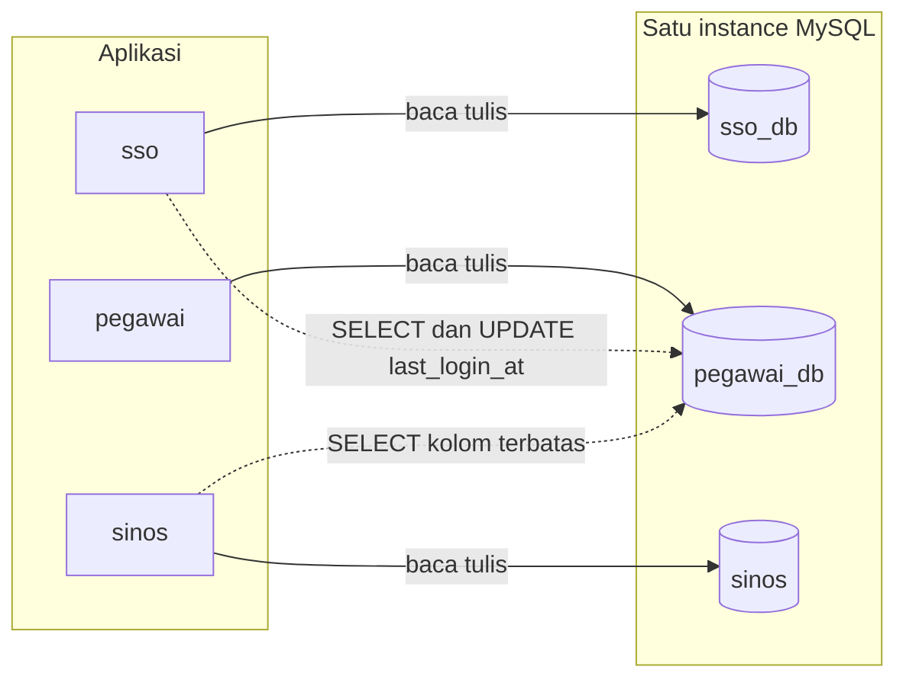
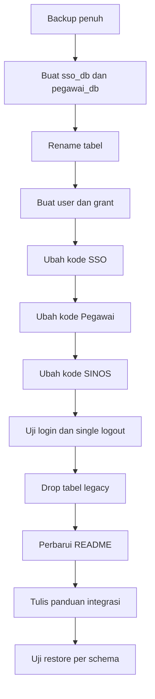

# Pemisahan Database SSO, Pegawai, dan SINOS

Status: **rencana**, menunggu persetujuan sebelum implementasi.

Keputusan arsitektur: **3 schema di 1 instance MySQL**. Bukan 3 server. Ini pilihan
paling ringan untuk aplikasi internal karena `RENAME TABLE` lintas schema bersifat
atomik, join lintas schema tetap bisa, dan tidak ada sinkronisasi data.

| Schema       | Pemilik    | Isi                                                                          |
| ------------ | ---------- | ---------------------------------------------------------------------------- |
| `sso_db`     | `sso/`     | `sso_token`, `sso_nonce`, `sso_audit_log`, `sso_client`                      |
| `pegawai_db` | `pegawai/` | `pegawai`, `pegawai_role`, `ref_role`, `ref_jabatan`, audit, kontak, `api_*` |
| `sinos`      | `sinos/`   | `nosur`, `surmas`, `disposisi`, `ref_klasifikasi`                            |

## 1. Aturan kepemilikan dan akses



Aturan yang ditegakkan lewat grant, bukan lewat kesepakatan:

1. `sso_app` hanya boleh `SELECT` tabel identitas dan `UPDATE (last_login_at)`.
   Tidak boleh menyentuh `pass` untuk menulis.
2. `sinos_app` mendapat **column-level SELECT** ke `pegawai_db.pegawai`
   (`id, nip, nama, aktif, is_operator, id_jabatan`). Password hash **tidak
   terbaca sama sekali** oleh SINOS.
3. `pegawai_app` pemilik penuh `pegawai_db`.
4. Tidak ada aplikasi yang mendapat akses ke `sso_db` selain `sso_app`.

Konsekuensi penting: `SELECT *` dari SINOS ke tabel `pegawai` akan gagal. Itu
disengaja agar batas kepemilikan tidak bisa dilanggar tanpa ketahuan.

## 2. Migrasi database

File baru: `plans/sql/2026-10-17-pisah-database.sql` (dijalankan sebagai root).

```sql
-- 0. WAJIB: mysqldump --single-transaction --routines sinos > backup-sebelum-pisah.sql

CREATE DATABASE IF NOT EXISTS sso_db     CHARACTER SET utf8mb4 COLLATE utf8mb4_general_ci;
CREATE DATABASE IF NOT EXISTS pegawai_db CHARACTER SET utf8mb4 COLLATE utf8mb4_general_ci;

-- 1. Pindahkan tabel SSO (atomik, tanpa dump/restore)
RENAME TABLE
  sinos.sso_token      TO sso_db.sso_token,
  sinos.sso_nonce      TO sso_db.sso_nonce,
  sinos.sso_audit_log  TO sso_db.sso_audit_log,
  sinos.sso_client     TO sso_db.sso_client;

-- 2. Pindahkan tabel identitas
RENAME TABLE
  sinos.pegawai            TO pegawai_db.pegawai,
  sinos.pegawai_role       TO pegawai_db.pegawai_role,
  sinos.ref_role           TO pegawai_db.ref_role,
  sinos.ref_jabatan        TO pegawai_db.ref_jabatan,
  sinos.pegawai_audit_log  TO pegawai_db.pegawai_audit_log,
  sinos.pegawai_kontak     TO pegawai_db.pegawai_kontak,
  sinos.api_client         TO pegawai_db.api_client,
  sinos.api_access_log     TO pegawai_db.api_access_log,
  sinos.api_nonce          TO pegawai_db.api_nonce;
```

Catatan eksekusi:

- `RENAME TABLE` lintas schema hanya berlaku pada instance yang sama. Ini alasan
  utama memilih 3 schema, bukan 3 server.
- Foreign key `pegawai_kontak -> pegawai` harus ikut berpindah. Verifikasi dengan
  `SHOW CREATE TABLE pegawai_db.pegawai_kontak` setelah rename.
- Cek view/trigger yang mereferensikan tabel yang dipindah:
  `SELECT * FROM information_schema.VIEWS WHERE TABLE_SCHEMA='sinos';`
- Tabel legacy `sinos.user` dan `sinos.jabatan` **belum** dihapus pada langkah ini.
  Keduanya baru di-drop pada langkah 5 setelah kode SINOS dirapikan.

### Grant

```sql
CREATE USER IF NOT EXISTS 'sso_app'@'localhost'     IDENTIFIED BY '<acak-1>';
CREATE USER IF NOT EXISTS 'pegawai_app'@'localhost' IDENTIFIED BY '<acak-2>';
CREATE USER IF NOT EXISTS 'sinos_app'@'localhost'   IDENTIFIED BY '<acak-3>';

-- SSO
GRANT SELECT, INSERT, UPDATE, DELETE ON sso_db.* TO 'sso_app'@'localhost';
GRANT SELECT ON pegawai_db.pegawai      TO 'sso_app'@'localhost';
GRANT SELECT ON pegawai_db.pegawai_role TO 'sso_app'@'localhost';
GRANT UPDATE (last_login_at) ON pegawai_db.pegawai TO 'sso_app'@'localhost';

-- Pegawai
GRANT SELECT, INSERT, UPDATE, DELETE ON pegawai_db.* TO 'pegawai_app'@'localhost';

-- SINOS: tulis hanya di schema sendiri, baca identitas kolom terbatas
GRANT SELECT, INSERT, UPDATE, DELETE ON sinos.* TO 'sinos_app'@'localhost';
GRANT SELECT (id, nip, nama, aktif, is_operator, id_jabatan)
  ON pegawai_db.pegawai TO 'sinos_app'@'localhost';
GRANT SELECT (pegawai_id, role_kode)
  ON pegawai_db.pegawai_role TO 'sinos_app'@'localhost';
GRANT SELECT (id, jabatan, subbag, kode)
  ON pegawai_db.ref_jabatan TO 'sinos_app'@'localhost';
```

Verifikasi grant wajib dilakukan sebelum aplikasi diarahkan:

```sql
SHOW GRANTS FOR 'sinos_app'@'localhost';
-- harus GAGAL:
--   SELECT pass FROM pegawai_db.pegawai;
--   UPDATE pegawai_db.pegawai SET pass='x' WHERE nip='admin';
```

## 3. Perubahan kode SSO

| File                                                         | Perubahan                                                                             |
| ------------------------------------------------------------ | ------------------------------------------------------------------------------------- |
| [`sso/lib/Db.php`](../../sso/lib/Db.php)                     | Tambah koneksi kedua `Db::identity()`; `pdo()` default `sso_db`; baca `IDENTITY_DB_*` |
| [`sso/lib/UserProvider.php`](../../sso/lib/UserProvider.php) | Semua query identitas lewat `Db::identity()`                                          |
| [`sso/config.php`](../../sso/config.php)                     | Default DB `sso_db`; tambah blok `identity_db`; perbarui komentar kepemilikan         |
| [`sso/.env.example`](../../sso/.env.example)                 | `DB_DATABASE=sso_db` plus `IDENTITY_DB_DATABASE=pegawai_db` dan kredensialnya         |
| `sso/controllers/MetaController.php`                         | **Baru**: `GET /meta` untuk discovery kontrak publik                                  |
| [`sso/index.php`](../../sso/index.php)                       | Daftarkan route `meta`                                                                |
| [`sso/README.md`](../../sso/README.md)                       | Tulis ulang: kepemilikan `sso_db`, grant, registrasi klien, tautan panduan integrasi  |

Prinsip yang dipertahankan: `sso_token` menyimpan snapshot `nip`, `nama`, `roles`.
Artinya `validate`, `userinfo`, dan `introspect` **tidak menyentuh `pegawai_db`**.
Hanya proses login yang membaca identitas. Ini membuat SSO tetap hidup walau
aplikasi pegawai sedang maintenance.

## 4. Perubahan kode Pegawai

| File                                                                                       | Perubahan                                                                 |
| ------------------------------------------------------------------------------------------ | ------------------------------------------------------------------------- |
| [`pegawai/application/config/database.php`](../../pegawai/application/config/database.php) | Default `pegawai_db`; hapus komentar DB bersama                           |
| [`pegawai/.env.example`](../../pegawai/.env.example)                                       | `DB_DATABASE=pegawai_db`                                                  |
| `pegawai/db/001_schema.sql`                                                                | **Baru**: skema lengkap `pegawai_db` (gabungan migrasi lama + paket inti) |
| [`pegawai/README.md`](../../pegawai/README.md)                                             | Tulis ulang: pemilik `pegawai_db`, daftar tabel, API v1, grant            |

`pegawai/plans/sql/2026-10-17-paket-inti.sql` tetap disimpan sebagai riwayat, tetapi
diberi header bahwa skema acuan sekarang ada di `db/001_schema.sql`.

## 5. Perubahan kode SINOS

| File                                                                                               | Perubahan                                                                                                                                                |
| -------------------------------------------------------------------------------------------------- | -------------------------------------------------------------------------------------------------------------------------------------------------------- |
| [`sinos/application/config/database.php`](../../sinos/application/config/database.php)             | Default tetap `sinos`; perbarui komentar bahwa identitas ada di `pegawai_db`                                                                             |
| [`sinos/application/models/M_user.php`](../../sinos/application/models/M_user.php)                 | Ganti semua nama tabel menjadi `pegawai_db.pegawai`, `pegawai_db.ref_jabatan`, `pegawai_db.pegawai_role`; **hapus `SELECT *`** dan pilih kolom eksplisit |
| [`sinos/application/models/M_disposisi.php`](../../sinos/application/models/M_disposisi.php)       | Baris 59, 98, 155, 180: ganti `user` menjadi `pegawai_db.pegawai`; `operator` menjadi `is_operator`                                                      |
| [`sinos/application/models/M_nosur.php`](../../sinos/application/models/M_nosur.php)               | Baris 24 dan 38: join ke `pegawai_db.pegawai`                                                                                                            |
| [`sinos/application/controllers/Disposisi.php`](../../sinos/application/controllers/Disposisi.php) | Baris 34: `get('user')` menjadi `get('pegawai_db.pegawai')` dengan kolom `nip`, `is_operator`                                                            |
| [`sinos/application/controllers/Auth.php`](../../sinos/application/controllers/Auth.php)           | Hapus `UPDATE pegawai.pass` pada baris 64 dan 150; `changepassword` dialihkan ke aplikasi pegawai                                                        |
| [`sinos/application/models/M_jabatan.php`](../../sinos/application/models/M_jabatan.php)           | Hapus bila tidak dipakai lagi setelah verifikasi grep                                                                                                    |
| [`sinos/.env.example`](../../sinos/.env.example)                                                   | `DB_DATABASE=sinos` plus `DB_USERNAME=sinos_app`                                                                                                         |
| [`sinos/README.md`](../../sinos/README.md)                                                         | Tulis ulang: kepemilikan `sinos`, baca-saja identitas, tanpa tulis password, migrasi                                                                     |

Penanganan ganti password di SINOS (paling ringan, tanpa endpoint baru):

```php
public function changepassword()
{
    redirect(rtrim($this->config->item('pegawai_app_url'), '/') . '/ganti-password');
}
```

Setelah semua referensi `user` dan `jabatan` hilang:

```sql
DROP TABLE sinos.user;
DROP TABLE sinos.jabatan;
```

Sebelum drop, jalankan pemeriksaan kesetaraan data:

```sql
SELECT COUNT(*) FROM sinos.jabatan;
SELECT COUNT(*) FROM pegawai_db.ref_jabatan;
-- bandingkan id, nama, subbag, kode
```

## 6. Dokumen integrasi SSO yang mandiri

File baru: `docs/integrasi-sso.md` di root workspace, **di luar folder `sso/`**.
Dokumen ini harus cukup untuk tim aplikasi lain tanpa membuka folder atau database
SSO. Isi wajib:

1. Ringkasan arsitektur dan istilah (`app_id`, `ticket`, `session_group`, `state`).
2. Prasyarat: minta admin SSO mendaftarkan `app_id`, `redirect_uri`, dan secret.
3. Tabel endpoint: `authorize`, `validate`, `userinfo`, `introspect`, `logout`,
   `logout-all`, `meta`.
4. Algoritma signature lengkap dengan contoh nilai konkret.
5. Diagram alur login, termasuk aturan `state` dan penyimpanan sesi lokal.
6. Contoh kode: PHP native, CodeIgniter 3, Laravel, dan Node.js.
7. Tabel kode error dan artinya.
8. Checklist keamanan: HTTPS, secret di env, jangan log ticket, sinkronisasi jam,
   whitelist redirect, validasi ticket wajib server-to-server.
9. Larangan eksplisit: jangan membaca `sso_db`, jangan memakai secret bersama
   antar aplikasi, jangan percaya `ticket` tanpa `validate`.
10. Troubleshooting: `invalid_signature`, `timestamp_out_of_window`,
    `nonce_replayed`, `ticket_used`, `ticket_expired`, `invalid_client`.
11. Prosedur logout dan single logout.
12. Prosedur rotasi secret tanpa downtime.

### Endpoint discovery

`GET /sso/meta` mengembalikan kontrak publik tanpa rahasia:

```json
{
	"ok": true,
	"issuer": "http://localhost/sso",
	"version": "1.0",
	"endpoints": {
		"authorize": "/authorize",
		"validate": "/validate",
		"userinfo": "/userinfo",
		"introspect": "/introspect",
		"logout": "/logout",
		"logout_all": "/logout-all"
	},
	"signature": {
		"alg": "HMAC-SHA256",
		"validate_base": "app_id\\nticket\\nts\\nnonce",
		"group_base": "app_id\\nsession_group\\nts\\nnonce"
	},
	"ticket_ttl": 60,
	"ts_window": 300
}
```

Dengan endpoint ini, tim integrasi cukup menulis satu skrip probe ke `/sso/meta`
untuk memastikan kontrak, tanpa membaca source.

## 7. Urutan eksekusi



## 8. Uji terima

| Uji                                                           | Harapan                                  |
| ------------------------------------------------------------- | ---------------------------------------- |
| Login SSO dengan akun `admin`                                 | Berhasil, `last_login_at` terisi         |
| `sso_app` menjalankan `UPDATE pegawai SET pass=...`           | Ditolak MySQL                            |
| `sinos_app` menjalankan `SELECT pass FROM pegawai_db.pegawai` | Ditolak MySQL                            |
| SINOS membuka daftar pegawai                                  | Berhasil, kolom eksplisit                |
| Disposisi menampilkan nama pengirim                           | Join lintas schema berhasil              |
| Login ke SINOS lalu buka Pegawai                              | Tanpa login ulang                        |
| Logout dari salah satu aplikasi                               | Semua sesi berakhir                      |
| API v1 Pegawai                                                | Respons sama seperti sebelum pemisahan   |
| Restore dump `sinos` saja                                     | Data pegawai dan token SSO tidak berubah |
| Hapus `sinos_db`                                              | Tidak relevan; schema terpisah           |

## 9. Rollback

1. Hentikan ketiga aplikasi.
2. Kembalikan `.env` ke nilai lama.
3. `RENAME TABLE` balik ke `sinos`.
4. Restore dump pra-migrasi bila ada perubahan data selama jendela uji.
5. `DROP DATABASE sso_db; DROP DATABASE pegawai_db;` setelah dipastikan kosong.

Rollback aman karena tidak ada transformasi data, hanya pemindahan tabel.

## 10. Risiko

| Risiko                                                                                    | Mitigasi                                                             |
| ----------------------------------------------------------------------------------------- | -------------------------------------------------------------------- |
| Grant lupa diberikan                                                                      | Uji koneksi per aplikasi sebelum cutover                             |
| FK tidak ikut pindah                                                                      | Verifikasi `SHOW CREATE TABLE` setelah rename                        |
| Query `SELECT *` di SINOS                                                                 | Ubah ke kolom eksplisit sebelum grant diterapkan                     |
| `sinos/plans/sql/sinos-backup-sebelum-paket-inti.sql` memuat hash password dan secret SSO | Pindahkan keluar repo atau hapus setelah migrasi                     |
| Dua sumber jabatan                                                                        | Drop `sinos.jabatan` setelah verifikasi kesetaraan                   |
| Dokumen integrasi basi                                                                    | `/sso/meta` menjadi acuan; dokumen hanya menjelaskan cara memakainya |
