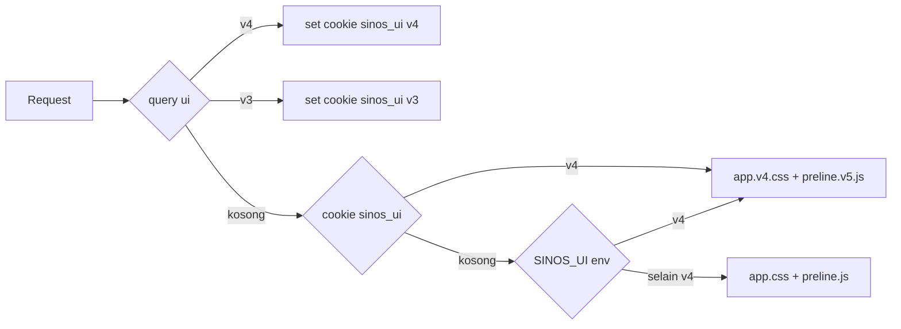

# SINOS — Redesign UI: Tailwind CSS 4 + Preline 5

Dokumen rencana. Tanggal: 2026-10-17. Lingkup: `c:/laragon/www/sinos` (CodeIgniter 3.1.13).
Dokumen ini **tidak mengubah kode aplikasi**; hanya rencana eksekusi.

---

## 1. Ringkasan & Keputusan

**Verdict: FEASIBLE — YES.** Migrasi Tailwind 3.4 → 4.3 + Preline 2.7 → 5.0 dapat dilakukan tanpa
menyentuh arsitektur CI3, tanpa build step runtime, dan dapat di-rollback dalam satu langkah.

Tiga catatan yang harus diterima sebelum mulai:

1. **Preline MCP butuh token.** `https://mcp.preline.co` mengembalikan `401` tanpa bearer token.
   Paket `@preline/mcp` / `preline-mcp` **404 di npm**. Tidak ada `.vscode/mcp.json` di workspace.
   MCP hanya "nice to have" (Fase E) — bukan blocker, karena `node_modules/preline` sudah memuat
   seluruh sumber komponen.
2. **`preline@5.0.0` mem-pin `engines.node = 22.22.2`.** Node lokal 24.20.0 → `EBADENGINE` warning
   (non-fatal selama `engine-strict=false`, yang merupakan default npm). Jangan set
   `engine-strict=true` di `.npmrc`.
3. **`assets/css/app.css` gitignored** (`.gitignore:13`). Build v4 harus **di-commit** sebagai
   `assets/css/app.v4.css` agar Apache/Laragon tidak butuh Node saat deploy.

### Tabel versi

| Paket                  | Sekarang    | Target        | Catatan                                            |
| ---------------------- | ----------- | ------------- | -------------------------------------------------- |
| `tailwindcss`          | 3.4.17      | 4.3.3         | CLI v4 pindah ke `@tailwindcss/cli`                |
| `@tailwindcss/cli`     | —           | 4.3.3         | binary `tailwindcss` v4                            |
| `@tailwindcss/postcss` | —           | 4.3.3         | tidak dipakai (tanpa `postcss.config.js`)          |
| `preline`              | 2.7.0       | 5.0.0         | tanpa `plugin.js`; ada `variants.css`, `theme.css` |
| Node                   | 24.20.0     | 24.20.0       | warning `EBADENGINE`, diterima                     |
| npm                    | 12.0.2      | 12.0.2        | lockfile: `package-lock.json`                      |
| CodeIgniter            | 3.1.13      | tidak berubah | rewrite `RewriteBase /sinos/`                      |
| DataTables             | 2.1.8 (CDN) | tidak berubah | jangan double-init                                 |
| jQuery                 | 3.7.1 (CDN) | tidak berubah | dipakai DataTables                                 |

### Prinsip desain eksekusi

- **Kontrak kelas tidak berubah.** 2.451 baris view tetap memakai `.btn`, `.card`, `.badge`,
  `.table`, `.alert`, `.nav-item`, `.input`, `.select`, `.dropdown-*`, `.avatar`, `.empty-state`.
  Yang berubah hanya definisi CSS-nya. Ini yang membuat migrasi murah dan reversible.
- **Parallel rollout.** Output v4 ke file baru `assets/css/app.v4.css`; `app.css` (v3) tetap utuh.
  Saklar: cookie `sinos_ui` / query `?ui=v4` / env `SINOS_UI=v4`.
- **Nol perubahan copy Indonesia.** Semua teks tetap verbatim.

---

## 2. Target Arsitektur Aset

### Layout file setelah migrasi

```
sinos/
├── package.json                  # script v3 + v4 berdampingan
├── tailwind.config.js            # DIHAPUS setelah Fase A lolos gate (config pindah ke @theme)
├── assets/
│   ├── css/
│   │   ├── input.css             # entry tunggal v4: @import tailwindcss + @theme + komponen
│   │   ├── app.css               # OUTPUT v3 — tetap ada, gitignored
│   │   └── app.v4.css            # OUTPUT v4 — DI-COMMIT
│   └── js/
│       ├── preline.js            # v2.7.0, dipertahankan untuk rollback
│       ├── preline.v2.js         # salinan commit-able dari preline.js
│       ├── preline.v5.js         # salinan dist preline 5
│       └── app.js                # tidak berubah perilaku, hanya tambahan handler
├── application/
│   ├── helpers/
│   │   ├── sinos_helper.php      # svg_icon(), hs_select_attr() → rename util v4
│   │   └── ui_helper.php         # BARU: ui_variant(), ui_css_tag(), ui_js_tag()
│   └── views/                    # kontrak kelas dipertahankan
└── .vscode/mcp.json              # Fase E opsional
```

### Mekanisme flag (parallel rollout)

`application/helpers/ui_helper.php` (baru, di-autoload lewat `application/config/autoload.php`
setelah `sinos`):

```php
function ui_variant()
{
    $q = isset($_GET['ui']) ? strtolower((string) $_GET['ui']) : '';
    if ($q === 'v4' || $q === 'v3') {
        setcookie('sinos_ui', $q, time() + 86400 * 30, '/sinos/');
        return $q;
    }
    if (! empty($_COOKIE['sinos_ui']) && in_array($_COOKIE['sinos_ui'], array('v3', 'v4'), TRUE)) {
        return $_COOKIE['sinos_ui'];
    }
    return getenv('SINOS_UI') === 'v4' ? 'v4' : 'v3';
}

function ui_css_tag()
{
    $file = ui_variant() === 'v4' ? 'assets/css/app.v4.css' : 'assets/css/app.css';
    if (! is_file(FCPATH . $file)) {
        $file = 'assets/css/app.css'; // fail-safe: v4 belum dibuild
    }
    $v = @filemtime(FCPATH . $file);
    return '<link rel="stylesheet" href="' . base_url($file) . ($v ? '?v=' . $v : '') . '">';
}

function ui_js_tag()
{
    $file = ui_variant() === 'v4' ? 'assets/js/preline.v5.js' : 'assets/js/preline.js';
    if (! is_file(FCPATH . $file)) {
        $file = 'assets/js/preline.js';
    }
    $v = @filemtime(FCPATH . $file);
    return '<script src="' . base_url($file) . ($v ? '?v=' . $v : '') . '"></script>';
}
```



**Kenapa cookie, bukan hanya query?** `_tahun_selector.php` melakukan `GET` form yang akan
membuang `?ui=v4` dari URL. Cookie membuat flag bertahan melewati submit GET, redirect SSO, dan
navigasi sidebar.

**Tiga titik `<link>` yang wajib diganti** (hanya ini yang menyentuh CSS):

| File                                          | Baris | Ganti dengan           |
| --------------------------------------------- | ----- | ---------------------- |
| `application/views/layouts/master.php`        | 14–15 | `<?= ui_css_tag(); ?>` |
| `application/views/auth/login.php`            | 12–13 | `<?= ui_css_tag(); ?>` |
| `application/views/surat_masuk/disposisi.php` | 10–11 | `<?= ui_css_tag(); ?>` |

`master.php:231–232` → `<?= ui_js_tag(); ?>`.

---

## 3. Fase A — Build Pipeline (Tailwind 4 + Preline 5)

### A1. Instalasi

```bash
cd c:/laragon/www/sinos
npm config set engine-strict false
npm install -D tailwindcss@3.4.17 @tailwindcss/cli@4.3.3 preline@5.0.0
```

Verifikasi hoisting (WAJIB — v3 harus tetap di root agar rollback hidup):

```bash
node -e "console.log(require('tailwindcss/package.json').version)"   # harus 3.4.17
node -e "console.log(require('@tailwindcss/cli/package.json').version)" # harus 4.3.3
node -e "console.log(require('preline/package.json').version)"       # harus 5.0.0
ls node_modules/preline/dist
```

Bila `tailwindcss` root ter-hoist ke 4.x, fallback: isolasi v4 di `tools/tw4/` dengan
`package.json` sendiri dan jalankan `npm --prefix tools/tw4 run build`.

### A2. Script `package.json`

```json
{
	"scripts": {
		"build": "tailwindcss -i ./assets/css/input.css -o ./assets/css/app.css --minify",
		"watch": "tailwindcss -i ./assets/css/input.css -o ./assets/css/app.css --watch",
		"build:v4": "tailwindcss -i ./assets/css/input.css -o ./assets/css/app.v4.css --minify",
		"watch:v4": "tailwindcss -i ./assets/css/input.css -o ./assets/css/app.v4.css --watch",
		"copy:preline": "node -e \"const fs=require('fs');fs.copyFileSync('node_modules/preline/dist/preline.js','assets/js/preline.v5.js');console.log('preline.v5.js',fs.statSync('assets/js/preline.v5.js').size)\""
	}
}
```

Catatan: script `build:v4` memakai binary `tailwindcss` yang di-resolve dari
`node_modules/.bin/tailwindcss`. Bila bentrok, tulis eksplisit
`node ./node_modules/@tailwindcss/cli/dist/index.mjs -i ... -o ...`.

**Bundle JS Preline 5 tanpa bundler:** `npm run copy:preline`. Bila `dist/preline.js` tidak ada
(hanya ESM), fallback: `<script type="module" src="assets/js/preline.v5.mjs">` dengan salinan
`node_modules/preline/dist/preline.mjs`; `HSStaticMethods.autoInit()` tetap global.

### A3. Header blok `assets/css/input.css` (persis)

```css
@import "tailwindcss";

/* Scan sumber aplikasi. JANGAN glob assets/js/**/*.js — preline.js 309 KB bikin build lambat. */
@source "../../application/views/**/*.php";
@source "../../application/helpers/**/*.php";
@source "../../assets/js/app.js";

/* Kelas yang dipakai komponen Preline di runtime (overlay/dropdown/select). */
@source "../../node_modules/preline/dist/*.js";
@source not "../../assets/js/preline.js";
@source not "../../assets/js/preline.v5.js";

@import "preline/variants.css";

@theme {
  /* ---------- Merek (port dari tailwind.config.js) ---------- */
  --color-brand-50:  #eef2fb;
  --color-brand-100: #dbe3f7;
  --color-brand-200: #b9c7ee;
  --color-brand-300: #8ea4e0;
  --color-brand-400: #5d7dcc;
  --color-brand-500: #3b5cb2;
  --color-brand-600: #2b4795;
  --color-brand-700: #1f3579;
  --color-brand-800: #152a63;
  --color-brand-900: #0a2463;
  --color-brand-950: #071a45;

  --color-accent-50:  #fff1f1;
  --color-accent-100: #ffe0e1;
  --color-accent-200: #ffc6c8;
  --color-accent-300: #ff9ea2;
  --color-accent-400: #ff656b;
  --color-accent-500: #fb3640;
  --color-accent-600: #e81c28;
  --color-accent-700: #c4131e;
  --color-accent-800: #a2141d;
  --color-accent-900: #86171f;

  /* ---------- Token semantik baru (dipakai definisi komponen) ---------- */
  --color-canvas: #f6f7f9;
  --color-surface: #ffffff;
  --color-line: #e5e7eb;
  --color-line-soft: #eef1f4;

  /* ---------- Tipografi ---------- */
  --font-sans: "Inter", ui-sans-serif, system-ui, -apple-system, "Segoe UI", sans-serif;

  /* ---------- Radius (lebih lembut dari v3) ---------- */
  --radius-lg: 0.625rem;
  --radius-xl: 0.875rem;
  --radius-2xl: 1rem;

  /* ---------- Elevasi ---------- */
  --shadow-card: 0 1px 2px 0 rgb(15 23 42 / 0.04), 0 1px 3px 0 rgb(15 23 42 / 0.06);
  --shadow-pop:  0 10px 24px -6px rgb(15 23 42 / 0.14), 0 2px 6px -2px rgb(15 23 42 / 0.08);
}
```

Tiga hal yang wajib ada agar tampilan v3 tidak "bergeser":

```css
@layer base {
	/* v4 mengubah default border-color menjadi currentColor */
	*,
	::before,
	::after,
	::backdrop {
		border-color: var(--color-line);
	}

	html {
		-webkit-text-size-adjust: 100%;
		scroll-behavior: smooth;
	}
	body {
		background-color: var(--color-canvas);
		color: var(--color-gray-800);
		-webkit-font-smoothing: antialiased;
		font-feature-settings: "cv11", "ss01";
	}
	[hidden] {
		display: none !important;
	}
}
```

`preline/plugin` **dihapus** dari konfigurasi; fungsi `hs-*` variant dipindahkan ke
`@import "preline/variants.css"`. Plugin `@tailwindcss/forms` **tidak** dipakai (input sudah
di-styling manual; menambahkannya akan menabrak `.input`/`.select`).

### A4. Spike `@apply` berantai — DECISION GATE

Tailwind v4 hanya mengizinkan `@apply` untuk _utility_; kelas biasa di `@layer components`
tidak otomatis dapat di-`@apply`. Chained apply yang terdampak:

| Baris                                  | Deklarasi                                              | Bergantung pada          |
| -------------------------------------- | ------------------------------------------------------ | ------------------------ |
| 53, 57, 61, 65, 69                     | `.btn-primary/-secondary/-outline/-ghost/-destructive` | `@apply btn …`           |
| 102                                    | `.textarea`                                            | `@apply input …`         |
| 161, 165, 169, 173, 177, 181, 185, 189 | `.badge-*`                                             | `@apply badge …`         |
| 250, 254, 258, 262, 266                | `.alert-*`                                             | `@apply alert …`         |
| 282                                    | `.dropdown-item-destructive`                           | `@apply dropdown-item …` |

Prosedur spike (30 menit, di branch `spike/tw4`):

1. Salin `input.css` apa adanya, ganti 3 baris `@tailwind *` dengan header A3. Jalankan
   `npm run build:v4`.
2. **Ekspektasi:** gagal dengan `Cannot apply unknown utility class: btn` (atau `input`, `badge`).
   Catat pesan persisnya di PR.
3. **Spike 2 — `@utility`.** Ubah basis (`btn`, `input`, `badge`, `alert`, `dropdown-item`,
   `card`, `nav-item`) dari `.btn { … }` menjadi `@utility btn { … }` (deklarasi isi identik).
   Selector turunan (`.table thead th`, `.nav-item-active [data-nav-icon]`,
   `.table td.col-aksi > *`) **tetap** di `@layer components` karena bukan utility datar.
4. **Spike 3 — flatten.** Bila `@utility` juga gagal/kacau, duplikasi deklarasi basis ke tiap
   varian (tanpa `@apply` berantai). Ukuran CSS naik ±6–8 KB, tidak masalah.

**Gate keputusan:**

| Hasil spike                        | Keputusan                                             |
| ---------------------------------- | ----------------------------------------------------- |
| Langkah 1 sukses                   | Lanjut apa adanya (paling murah)                      |
| Langkah 3 sukses & diff visual nol | Pakai `@utility` untuk 7 kelas basis                  |
| Keduanya gagal                     | Flatten; catat di `input.css` sebagai komentar alasan |

Jangan lanjut ke Fase B sebelum gate ini hijau.

### A5. Rename utility v3 → v4 (wajib, ada di `input.css` + views + helper)

| v3                            | v4                                                | Alasan                                                       |
| ----------------------------- | ------------------------------------------------- | ------------------------------------------------------------ |
| `shadow-sm` (×3)              | `shadow-xs`                                       | skala shadow digeser                                         |
| `shadow` (×1)                 | `shadow-sm`                                       | idem                                                         |
| `outline-none` (×7)           | `outline-hidden`                                  | `outline-none` v4 = `outline-style:none` tanpa forced-colors |
| `!border-transparent`         | `border-transparent!`                             | prefiks `!` → sufiks                                         |
| `!shadow-none`                | `shadow-none!`                                    | idem                                                         |
| `ring-1` (×1)                 | tetap, tapi **selalu** pasangkan warna            | default `ring` v4 = 1px, warna `currentColor`                |
| `ring-2` (×5)                 | tetap, tapi **selalu** pasangkan `ring-brand-900` | warna default berubah                                        |
| `focus-visible:ring-offset-*` | prefer `outline-2 outline-offset-2`               | lebih andal di forced-colors                                 |

Titik kena yang sudah teridentifikasi:

- `assets/css/input.css:47, 61, 82, 93, 95, 275, 298, 341`
- `application/views/layouts/logout_modal.php:14` (`!border-transparent !shadow-none`)
- `application/views/surat_masuk/daftar.php:164` (idem)
- `application/helpers/sinos_helper.php:254` (`focus:outline-none`, `focus:ring-1`)
- `application/views/surat_masuk/disposisi.php:94` (`ml-auto !h-3.5 !w-3.5`)

Perintah audit ulang:

```bash
grep -rn "shadow-sm\|outline-none\|ring-1\|ring-2\|![a-z-]*:" application/views application/helpers assets/css
```

---

## 4. Fase B — Design System v4

### Arah visual (konkret)

- **Identitas tetap:** navy `#0a2463` (brand-900) sebagai warna aksi utama, merah `#fb3640`
  (accent-500) hanya untuk aksen sekunder/CTA alternatif, Inter sebagai satu-satunya font.
- **Permukaan berlapis:** kanvas `#f6f7f9` → kartu putih ber-border `#e5e7eb` → sub-permukaan
  `#f9fafb` untuk header tabel, footer kartu, dan blok meta. Tidak ada kartu "melayang" tanpa border.
- **Radius lebih lembut:** kontrol 10px (`rounded-lg` = 0.625rem), kartu/modal 14px
  (`rounded-xl` = 0.875rem), pill/badge tetap `rounded-md`.
- **Elevasi hemat:** hanya dua level — `shadow-card` (kartu) dan `shadow-pop` (dropdown/modal).
  Hover kartu tidak menambah shadow, hanya mengubah border ke `brand-300`.
- **Focus ring seragam:** `outline-2 outline-offset-2 outline-brand-500` pada semua kontrol
  interaktif. Tidak ada lagi campuran `ring`/`outline` antar komponen.
- **Tabel lebih padat:** header 11px uppercase `tracking-[0.06em]`, body 13px, padding sel
  `px-3.5 py-2.5`, angka `tabular-nums`, zebra hanya untuk baris arsip.
- **State variant Preline-kompatibel:** `.hs-dropdown-menu.open { display:block }`,
  `hs-dropdown-open:*`, `hs-overlay-open:*`, `hs-selected:*` harus tetap berfungsi.

### Token set final

| Token                            | Nilai            | Dipakai oleh                                                    |
| -------------------------------- | ---------------- | --------------------------------------------------------------- |
| `--color-brand-900`              | `#0a2463`        | `.btn-primary`, `.nav-item-active`, `.avatar`, `.badge-default` |
| `--color-accent-500`             | `#fb3640`        | `.btn-secondary`, aksen grafik                                  |
| `--color-canvas`                 | `#f6f7f9`        | `body`                                                          |
| `--color-surface`                | `#ffffff`        | `.card`, `.dropdown-menu`, modal                                |
| `--color-line`                   | `#e5e7eb`        | border kartu/tabel                                              |
| `--color-line-soft`              | `#eef1f4`        | border baris tabel                                              |
| `--radius-lg/xl/2xl`             | `.625/.875/1rem` | kontrol / kartu / sheet                                         |
| `--shadow-card` / `--shadow-pop` | lihat A3         | kartu / dropdown+modal                                          |
| `--font-sans`                    | Inter stack      | seluruh UI                                                      |

### Kontrak kelas (nama TIDAK berubah)

| Kelas                                               | Perubahan definisi                                                                                                               |
| --------------------------------------------------- | -------------------------------------------------------------------------------------------------------------------------------- |
| `.btn`                                              | `rounded-lg`→`rounded-[var(--radius-lg)]`, `focus-visible:outline-2 outline-offset-2 outline-brand-500`, `active:translate-y-px` |
| `.btn-primary`                                      | tetap `bg-brand-900`, tambah `hover:bg-brand-800`, `shadow-xs`                                                                   |
| `.btn-secondary`                                    | tetap `bg-accent-500`, `hover:bg-accent-600`                                                                                     |
| `.btn-outline`                                      | `border-line` + `shadow-xs` + `hover:bg-gray-50`                                                                                 |
| `.btn-ghost`                                        | tidak berubah perilaku, radius ikut token                                                                                        |
| `.btn-destructive`                                  | tetap `bg-red-600`                                                                                                               |
| `.btn-sm` / `.btn-lg` / `.btn-icon`                 | `.btn-icon` naik ke 36×36px konsisten dengan `h-9` topbar                                                                        |
| `.label`                                            | `text-[0.8125rem] font-medium text-gray-700`                                                                                     |
| `.input`                                            | `border-line`, `shadow-xs`, `focus:border-brand-900 focus:ring-2 focus:ring-brand-900/20`                                        |
| `.textarea` / `.select`                             | turunan `.input`; `.select` tetap pakai chevron data-URI (warna `#6b7280`)                                                       |
| `.fieldset-legend`                                  | `text-[0.6875rem] uppercase tracking-[0.08em] text-gray-500`                                                                     |
| `.separator`                                        | `bg-line`                                                                                                                        |
| `.card`                                             | `rounded-[var(--radius-xl)] border-line bg-surface shadow-card`                                                                  |
| `.card-header/-title/-description/-content/-footer` | padding `px-5 py-4`, footer `bg-gray-50/60`                                                                                      |
| `.section-title/-subtitle`                          | ukuran tetap; subtitle `text-gray-500`                                                                                           |
| `.badge` + 8 varian                                 | `rounded-md px-2 py-0.5 text-[0.6875rem] font-medium leading-5`, border 1px                                                      |
| `.table`                                            | `text-[0.8125rem]`; `thead th` `bg-gray-50 text-[0.6875rem] uppercase`; `tbody td` `px-3.5 py-2.5`                               |
| `.col-prose/.col-nowrap/.col-aksi`                  | tetap, `col-aksi` `w-px text-right`                                                                                              |
| `.table-wrap`                                       | `overflow-x-auto rounded-b-[var(--radius-xl)]`                                                                                   |
| `.alert` + 5 varian                                 | ikon-led, `rounded-lg border p-3.5`, `[&_svg]:mt-0.5`                                                                            |
| `.dropdown-menu`                                    | `rounded-lg border-line shadow-pop p-1.5`                                                                                        |
| `.dropdown-item`                                    | `rounded-md px-2.5 py-2`, `hover:bg-gray-100`                                                                                    |
| `.dropdown-item-destructive`                        | tetap turunan `.dropdown-item`                                                                                                   |
| `.nav-item`                                         | `rounded-lg px-3 py-2`, ikon 16px, `hover:bg-gray-100`                                                                           |
| `.nav-item-active`                                  | `bg-brand-50 text-brand-900 font-semibold` + indikator batang kiri via `::before`                                                |
| `.nav-group-label`                                  | `pt-5 pb-1.5 text-[0.6875rem] uppercase tracking-[0.08em] text-gray-400`                                                         |
| `.avatar` / `.avatar-soft`                          | `.avatar` 32px, `.avatar-soft` 40px `rounded-lg bg-brand-50`                                                                     |
| `.empty-state` / `.empty-state-icon`                | ikon 44px `rounded-full bg-gray-100`, CTA di bawah teks                                                                          |
| `.focus-ring`                                       | diganti isi: `outline-2 outline-offset-2 outline-brand-500`                                                                      |
| `.hs-dropdown-menu.open`                            | `display:block` (dipertahankan)                                                                                                  |

**Aturan keras:** jangan menambah kelas baru yang mengandung `!` prefiks, jangan memakai
`@apply` berantai lebih dari satu tingkat setelah gate A4, dan jangan mengubah nama kelas
apa pun — 75 call site `svg_icon()` dan 2.451 baris view bergantung pada nama ini.

### Class string yang dihasilkan PHP (ikut dijaga)

| Lokasi                                        | Kontrak                                                                                                                                                                             |
| --------------------------------------------- | ----------------------------------------------------------------------------------------------------------------------------------------------------------------------------------- |
| `application/helpers/sinos_helper.php:117`    | `svg_icon($name, $classes)` — 57 path, 75 call site                                                                                                                                 |
| `application/helpers/sinos_helper.php:248`    | `hs_select_attr()` → `toggleClasses`/`dropdownClasses`/`optionClasses`; rename `outline-none`→`outline-hidden`, `ring-1` tetap 1px                                                  |
| `application/models/M_disposisi.php:231–243`  | `tone` mengembalikan nama `badge-*`; **jangan** ubah nama tone                                                                                                                      |
| `application/views/dashboard/index.php:12–35` | `tone` berupa string kelas Tailwind di dalam data (`bg-brand-50 text-brand-900`, `bg-sky-50`, `bg-amber-50`, `bg-red-50`, `bg-emerald-50`) — aman, hanya pastikan kelasnya ter-scan |

---

## 5. Fase C — Redesign Shell

Urutan kerja: `master.php` → `sidebar.php` → `topbar.php` → `footer.php` → `flash.php` →
`logout_modal.php` → `_tahun_selector.php`.

### C1. `application/views/layouts/master.php` (204 baris)

**Head (L4–160):**

- Pertahankan meta + `theme-color #0A2463` + Google Fonts Inter (L11–13).
- **Urutan baru:** DataTables CDN CSS (L19) **dipindah ke atas** `ui_css_tag()`.
  Dengan urutan ini CSS kita menang tanpa `!important`.
- **Hapus blok `<style>` 140 baris (L20–158).** Pindahkan re-skin DataTables ke
  `input.css` di `@layer components`, selector `.dt-container` / `table.dataTable`,
  tanpa `!important`, memakai token (`--color-line`, `--color-brand-900`, `--radius-lg`).
- Tambah `<meta name="csrf-token">`? **Tidak** — aplikasi tidak memakai CSRF; jangan diubah.
- `ui_css_tag()` menggantikan L14–15.

**Body:**

- `body class="h-full bg-canvas font-sans text-gray-800"` (ganti `bg-gray-50`).
- Sidebar + `#sidebarOverlay` (L164–168) dipertahankan; overlay ganti ke
  `bg-gray-900/40 backdrop-blur-[2px]`.
- Shell `lg:pl-64` tetap; `main` tetap `max-w-[110rem]`, padding `px-4 py-6 sm:px-6 lg:px-8`.
- Tambah `<div id="page-progress">`? Tidak — di luar lingkup.

**Script (L187–234) urutan final:**

1. jQuery 3.7.1 (CDN)
2. DataTables 2.1.8 (CDN)
3. Inline init DataTables — tetap `DOMContentLoaded`, tetap `data-datatable` + `data-nosort`,
   **tambah guard** `if (table.dataset.dtInit === '1') return; table.dataset.dtInit = '1';`
   dan `if (typeof DataTable === 'undefined') return;` untuk mencegah double-init.
4. `ui_js_tag()` → `preline.v5.js` (auto-init pada `window.load`)
5. `assets/js/app.js`

**Jangan diubah:** `$content`, `$title`, `$subtitle`, `$use_datatables`, nama view partial,
string bahasa DataTables (Indonesia, L198–212).

### C2. `application/views/layouts/sidebar.php` (101 baris)

- Brand block: kotak ikon `rounded-lg bg-brand-900` → `rounded-[var(--radius-lg)]`, tambah
  `ring-1 ring-brand-900/10`; teks tetap "SINOS" / "Pengadilan Agama Kupang".
- Hirarki: `.nav-group-label` (Surat Masuk / Surat Keluar / Laporan / Panduan) tetap; beri
  `border-t border-line-soft` pada grup kedua dan seterusnya untuk pemisah visual halus.
- **Indikator aktif:** `.nav-item-active::before` batang 3px `bg-brand-900` di kiri
  (`absolute inset-y-1.5 left-0 w-[3px] rounded-full`), plus `bg-brand-50`.
  Ini menggantikan satu-satunya sinyal warna agar lebih terbaca di sidebar putih.
- Ikon: `[data-nav-icon]` tetap jadi hook (dipakai `input.css:306`).
- Pill `disposisi_count` (L55–59): `bg-brand-900` → `bg-brand-900/10 text-brand-900` saat
  item aktif, `bg-brand-900 text-white` saat tidak aktif. Angka tetap `(int)`.
- Link PDF (L91–95): ikon `external-link` dengan kelas `ml-auto h-3.5 w-3.5 text-gray-400`
  (hapus prefiks `!`).
- Footer sidebar (L98–100): `text-[0.6875rem] text-gray-400`, tambah `SINOS v4` bila flag v4?
  **Tidak** — jangan tampilkan penanda versi ke pengguna.
- **Jangan diubah:** closure `$is()`, semua `base_url()` dan query `?tahun=`, gate
  `is_operator` / `is_admin`, teks menu Indonesia.
- Opsional (di luar scope inti): collapse desktop via `data-sidebar="collapsed"` di `<html>`
  - `lg:w-20` + `lg:pl-20`. Bila dikerjakan, `app.js` harus menyimpan preferensi di
    `localStorage`.

### C3. `application/views/layouts/topbar.php` (55 baris)

- Tinggi tetap `h-16`, `bg-white/85 backdrop-blur`, border bawah `border-line`.
- Kiri: tombol `#sidebarToggle` (`.btn-icon`) + judul. Tambah slot breadcrumb opsional:
  `<?php if (! empty($breadcrumb)): ?>` render `<nav aria-label="Breadcrumb">` dengan
  `$breadcrumb = array(array('label'=>'…','href'=>'…'))`. **Default kosong** → tidak ada
  perubahan perilaku bila controller tidak mengirim.
- Slot pencarian: hanya render bila `!empty($topbar_search_url)`; jangan mengarang endpoint.
- Kanan: `hs-dropdown` user menu dipertahankan (`[--placement:bottom-right]`,
  `[--auto-close:true]`, `#userMenuToggle`, `.avatar`, `data-hs-overlay="#logoutModal"`).
  Ganti `dropdown-menu … hidden opacity-0` → tetap sama (Preline butuh `hidden` awal).
- `focus:outline-none` pada toggle → `focus-visible:outline-2 focus-visible:outline-offset-2
focus-visible:outline-brand-500`.
- **Jangan diubah:** `$title`, `$subtitle`, `$initial`, `$user['nama']`, `$user['nip']`,
  `id="sidebarToggle"`, `id="userMenuToggle"`, `href` Panduan Klasifikasi, label "Logout".

### C4. `application/views/layouts/footer.php` (6 baris)

- Border atas `border-line`, teks `text-[0.6875rem] text-gray-400`.
- Tambah `<span class="tabular-nums">` pada tahun. Copy tetap:
  `© {YEAR} Pengadilan Agama Kupang` dan `SINOS — Sistem Informasi Nomor Surat`.

### C5. `application/views/layouts/flash.php` (21 baris)

- Struktur tetap: `data-flash` (dipakai auto-dismiss `app.js:27`), `role="alert"`,
  `$styles` map `success|error|warning|info` → `alert-*` + ikon + judul. **Jangan ubah map.**
- Tambah tombol tutup: `<button type="button" data-flash-dismiss class="btn-icon …">x</button>`
  dan handler kecil di `app.js` (`querySelectorAll('[data-flash-dismiss]')` → `closest('[data-flash]').remove()`).
- Ikon dibungkus `flex h-8 w-8 items-center justify-center rounded-full bg-white/70` agar
  ikon-led dan tetap terbaca di semua varian.
- Tambah `role="status"` untuk `success`/`info`? Cukup `role="alert"` seperti sekarang —
  jangan diubah agar tidak mengubah perilaku screen reader yang sudah diterima.

### C6. `application/views/layouts/logout_modal.php` (31 baris)

- Markup Preline 5 overlay: pertahankan `id="logoutModal"` (dirujuk topbar), `role="dialog"`,
  `tabindex="-1"`, `aria-labelledby="logoutTitle"`; **tambah** `aria-modal="true"`.
- Panel: `rounded-[var(--radius-xl)] border-line bg-surface shadow-pop`; animasi tetap
  `hs-overlay-open:opacity-100 hs-overlay-open:mt-7 transition-all duration-300 ease-out`.
- Tombol tutup: `btn-icon border-transparent! shadow-none!` (sufiks v4).
- Ikon header `bg-red-50 text-red-600`, ukuran 32px.
- **Jangan diubah:** `href="<?= base_url('logout'); ?>"`, teks konfirmasi Indonesia, label
  "Batal"/"Logout", `data-hs-overlay="#logoutModal"` pada kedua tombol.

### C7. `application/views/layouts/_tahun_selector.php` (22 baris)

- `.select h-9 w-[6.5rem]` → `h-9 w-[6.5rem] rounded-[var(--radius-lg)] text-sm`.
- Bungkus dalam `inline-flex items-center gap-2 rounded-lg border border-line bg-white px-2`
  agar menyatu dengan filter bar.
- **Jangan diubah:** `method="get"`, `action`, `name="tahun"`, `id="tahun"`,
  `name="tahun_submit" value="1"`, `onchange="this.form.submit()"`, label "Tahun",
  `foreach ($tahun_list as $y)`. Flag v4 aman karena cookie (lihat §2).

---

## 6. Fase D — Redesign Halaman

Urutan: `auth/login.php` → `dashboard/index.php` → `surat_masuk/daftar.php` →
`surat_masuk/{input,edit,detail,_form_fields}.php` → `surat_keluar/{daftar,daftar_all,_form_nomor_fields,edit,ambil,sisip,upload}.php` →
`disposisi/{index,detail,_form_ajax}.php` → `laporan/index.php`.

### D1. `application/views/auth/login.php` (106 baris, standalone)

- **Wajib:** ganti L12–13 → `ui_css_tag()`; tambah `<?= ui_js_tag(); ?>` sebelum `</body>`
  (halaman ini sekarang **tanpa JS sama sekali**).
- Panel merek: `bg-brand-900` → gradien halus `bg-brand-900` + `bg-[radial-gradient(...)]`
  overlay `brand-700/40`; tetap `lg:grid-cols-2`, `hidden lg:flex`.
- Kartu: `rounded-[var(--radius-2xl)] border-line shadow-card`; panel form padding `sm:p-10`.
- CTA SSO: `.btn-primary w-full` dipertahankan, ikon `log-out` `rotate-180` tetap.
- Error: `.alert-destructive` tetap; tambah `data-flash` agar auto-dismiss konsisten?
  **Tidak** — error login harus tetap terlihat; jangan tambah `data-flash`.
- **Jangan diubah:** `href="<?= base_url('sso/login'); ?>"`,
  `href="<?= base_url('login?local=1'); ?>"`, blok `$CI->config->load('sso', TRUE)` dan
  `sso_enabled`, `html_escape($error)`, seluruh copy ("Masuk ke SINOS", "Lanjut ke SSO",
  "Login lokal (cadangan)", footer copyright).

### D2. `application/views/dashboard/index.php` (124 baris)

- `$stats` (L7–38): **pertahankan struktur array** (`label/value/icon/tone/href`). Hanya
  `tone` boleh dirapikan ke pasangan `bg-*-50 text-*-700` yang konsisten; jangan ubah kunci.
- Stat card: `.card p-5` → tambah `relative overflow-hidden`, angka `text-[2rem] font-semibold
tabular-nums tracking-tight`, ikon `rounded-[var(--radius-lg)]`; hover hanya
  `hover:border-brand-300`.
- Tabel terbaru: `.card` + header `bg-gray-50/60`, `.table` padat, badge tetap
  `badge-warning`/`badge-muted`/`badge-success`.
- Empty state: ikon 44px, judul + deskripsi, CTA `.btn-primary btn-sm` di bawah.
- **Jangan diubah:** `$total_surat_keluar`, `$total_surat_masuk`, `$surat_keluar_saya`,
  `$belum_upload`, `$terbaru`, `$tahun`, `$s->no/tanggal/hal/tujuan/file`,
  `tanggal_indonesia()`, `number_format($v, 0, ',', '.')`, semua `href` ber-`?tahun=`.

### D3. `application/views/surat_masuk/daftar.php` (243 baris)

- **Filter bar baru** di `.card-header`: kiri judul + deskripsi, kanan `_tahun_selector` +
  tombol `Input Surat` (bila operator). Tidak menambah form GET baru.
- Tabel: `id="tblMasuk" data-datatable data-nosort="6"` **wajib dipertahankan** (dipakai
  inline init `master.php:193`). `.table` padat; kolom `No.` `w-10 text-gray-400 tabular-nums`.
- Status: `$st->tone` tetap dipakai apa adanya; `badge-outline` untuk "Belum didisposisi".
- Kolom aksi: `.btn-icon` 32px + `hs-dropdown` "Aksi lainnya" (markup L123–139). Pertahankan
  `data-confirm`, `target="_blank" rel="noopener"`.
- Modal disposisi (L152–173): Preline 5 overlay — tambah `aria-modal="true"`, panel
  `rounded-[var(--radius-xl)] shadow-pop`, tombol tutup `border-transparent! shadow-none!`.
- Inline `<script>` (L175–254): **jangan diubah logikanya** — `bukaDisposisi`,
  `tutupDisposisi`, `kirimDisposisiAjax`, `window.HSOverlay.open/close`, fallback
  `classList.add('open')`, `sinosInitPreline()`, `fetch` + `X-Requested-With`.
  Boleh hanya mengubah string kelas di dalam template `innerHTML`.
- **Jangan diubah:** `$rows`, `$status_disposisi`, `$can_send_map`, `$user`, `$tahun`,
  semua `base_url('surat-masuk/…')`, `onclick="bukaDisposisi(<?= (int) $r->id; ?>)"`,
  `id="modalDisposisi"`, `id="modalDisposisiBody"`, teks "Memuat…", "Gagal memuat form disposisi.".

### D4. `surat_masuk/{input,edit,detail,_form_fields}.php`

- `input.php` / `edit.php`: bungkus form dalam `.card`; header `.card-header` dengan
  `.card-title`; isi `.card-content`; footer `.card-footer` berisi `btn-primary` (Simpan) +
  `btn-outline` (Batal). Grid field `grid gap-4 sm:grid-cols-2`.
- `_form_fields.php`: **partial bersama** — setiap perubahan berlaku dua arah (input & edit).
  Ubah hanya kelas; pertahankan `name=`, `id=`, `value="<?= old('…') ?>"`, `form_error()`,
  `set_value()`, atribut `required`, `data-hs-select` dari `hs_select_attr()`.
- `detail.php`: layout dua kolom `lg:grid-cols-3` — kiri `lg:col-span-2` kartu data
  (`.table` dua kolom `w-48` label / nilai), kanan kartu meta + aksi (`.btn-outline btn-sm`,
  `.btn-primary btn-sm`). Badge status tetap memakai nama tone dari model.
- **Jangan diubah:** `form_open()`/`form_close()` (atau markup action eksplisit), seluruh
  `name=`/`id=`, `base_url('surat-masuk/simpan')` dsb., tanpa CSRF, copy Indonesia,
  `$row->*` property name.

### D5. `surat_keluar/{daftar,daftar_all,_form_nomor_fields,edit,ambil,sisip,upload}.php`

- `daftar.php` / `daftar_all.php`: filter bar (tahun + status) memakai `_tahun_selector`;
  tabel padat + DataTables (`data-datatable`, `data-nosort` sesuai kolom aksi); badge status
  tetap; tombol aksi `.btn-icon`.
- `_form_nomor_fields.php`: partial nomor surat (kode klasifikasi, nomor, tanggal). Ubah kelas
  saja; pertahankan urutan field, `name=`, `id=`, dan perilaku `huruf_sisip()` bila dipakai.
- `ambil.php` / `sisip.php`: kartu form terpusat `max-w-2xl`; preview nomor dalam blok
  `rounded-[var(--radius-lg)] bg-brand-50 px-4 py-3 font-mono text-lg text-brand-900`
  (teks preview tetap dari PHP, jangan dihitung ulang di JS).
- `upload.php`: dropzone sederhana — `.card` + `.input type=file` (styling `file:` di
  `.input` sudah ada), plus daftar berkas dalam `.table`.
- `edit.php`: sama seperti `surat_masuk/edit.php`.
- **Jangan diubah:** `name="file"`, `enctype="multipart/form-data"`, `MAX_FILE_SIZE`,
  `base_url('surat-keluar/…')`, `$tahun`, semua label Indonesia.

### D6. `disposisi/{index,detail,_form_ajax}.php`

- `index.php`: kartu daftar disposisi + `.table` padat; badge status dari `tone`;
  filter memakai `.select`.
- `detail.php`: timeline disposisi memakai `<ol class="relative border-s border-line ps-5">`
  dengan titik `absolute -start-[5px] size-2 rounded-full bg-brand-900`. Tanpa library baru.
- `_form_ajax.php`: **dirender ke dalam modal** `surat_masuk/daftar.php`. Pertahankan
  `id` field, `name="target"`, `form.action`, `onsubmit="return kirimDisposisiAjax(this)"`,
  dan atribut `data-hs-select` (Preline 5 butuh `hs_select_attr()` yang sudah diperbarui).
  Setelah `BODY.innerHTML = html`, `sinosInitPreline()` dipanggil — jangan hapus.
- **Jangan diubah:** endpoint `disposisi/form-ajax/{id}`, field `target`, seluruh copy,
  struktur `<form>`.

### D7. `laporan/index.php`

- Form parameter laporan dalam `.card` + `.card-footer`; tombol cetak `.btn-primary` membuka
  `laporan/pdf` (`target="_blank"` tetap).
- Tabel pratinjau memakai `.table` + `.table-wrap`. **`laporan/pdf.php` tidak disentuh** —
  itu dokumen cetak, bukan UI aplikasi.

### D8. Tidak disentuh

`application/views/errors/*` (stock CI3), `surat_keluar/daftar_all.php` bagian query,
`laporan/pdf.php`, `assets/img/*`, `assets/klasifikasi.pdf`.

---

## 7. Fase E — Opsional

### E1. Dark mode (tidak diminta; hanya bila disetujui)

1. Tambah di `input.css`: `@custom-variant dark (&:where(.dark, .dark *));`
2. Tambah token dark di `@theme`: `--color-canvas`, `--color-surface`, `--color-line` versi gelap
   (mis. `#0b1220`, `#111827`, `#1f2937`) dan varian `dark:` pada komponen.
3. Toggle: `<button data-theme-toggle>` di topbar; `app.js` menulis `localStorage.sinos_theme`
   dan `document.documentElement.classList.toggle('dark')`.
4. **Blocker:** 2.451 baris view memakai `bg-white`/`text-gray-900` literal. Dark mode penuh
   butuh audit kelas per halaman — jangan dijanjikan sebagai bagian migrasi ini.

### E2. Preline MCP

`.vscode/mcp.json` di dalam `sinos/`:

```json
{
	"servers": {
		"preline": {
			"type": "http",
			"url": "https://mcp.preline.co",
			"headers": { "Authorization": "Bearer ${input:preline_token}" }
		}
	}
}
```

- Tanpa token → `401`. Minta token di akun Preline; jangan commit token (pakai
  `${input:…}` / variabel environment).
- Paket npm `preline-mcp`, `@preline/mcp`, `@preline/mcp-server` **tidak ada** (404). Jangan
  mencoba `npx` paket tersebut.
- **Tanpa token, referensi komponen tetap lengkap secara lokal:**
  `node_modules/preline/src/plugins/**` (markup contoh per komponen),
  `node_modules/preline/dist/preline.js` (nama kelas & event), `node_modules/preline/variants.css`
  (daftar `hs-*` variant), plus skill katalog `preline-mcp` untuk daftar komponen/blocks.
- MCP hanya mempercepat pencarian contoh markup; tidak mengubah hasil build.

---

## 8. Verifikasi & Acceptance Criteria

### Build

```bash
cd c:/laragon/www/sinos
npm run build:v4          # harus exit 0, tanpa warning "unknown utility class"
npm run copy:preline
node -e "const fs=require('fs');const s=fs.readFileSync('assets/css/app.v4.css','utf8');console.log('bytes',s.length);['.btn-primary','.card','.table','.nav-item-active','.input','.badge','.alert','.dropdown-menu','.empty-state','hs-overlay-open','hs-dropdown-open','hs-selected','hs-select'].forEach(c=>console.log(c.padEnd(20),s.includes(c)))"
```

Semua baris grep harus `true` (khusus `hs-select`: bila `false`, verifikasi di runtime DOM —
kelas itu ditambahkan JS Preline, bukan harus ada di CSS).

### Lint PHP

```bash
for /r application\views %f in (*.php) do @php -l "%f"
php -l application/helpers/ui_helper.php
php -l application/helpers/sinos_helper.php
```

Harus `No syntax errors detected` untuk setiap file yang diubah.

### Visual (manual, dengan flag `?ui=v4`)

| Halaman                          | 1440px                                            | 390px                               |
| -------------------------------- | ------------------------------------------------- | ----------------------------------- |
| `/sinos/login`                   | panel merek tampil, kartu tidak melebihi viewport | panel merek tersembunyi, form penuh |
| `/sinos/dashboard`               | 4 stat card sejajar, tabel tidak overflow         | 1 kolom, tabel scroll horizontal    |
| `/sinos/surat-masuk/daftar`      | filter bar 1 baris, tabel 7 kolom muat            | filter wrap, kolom aksi terlihat    |
| `/sinos/surat-masuk/detail/{id}` | 2 kolom                                           | 1 kolom                             |

### Fungsional

- DevTools Console: **nol** error, nol warning `Cannot apply` / `Preline` / `DataTables`.
- DataTables: `document.querySelectorAll('.dt-container').length === 1` per tabel;
  `table.dataset.dtInit === '1'`.
- Preline: dropdown user menu buka/tutup; `#logoutModal` buka/tutup; `hs-select` pada form
  disposisi AJAX berfungsi setelah `sinosInitPreline()`.
- Sidebar mobile: `#sidebarToggle` + `#sidebarOverlay` berfungsi.
- Flash: auto-dismiss 4 detik **dan** tombol tutup manual berfungsi.

### Copy Indonesia

```bash
git diff -U0 -- application/views | findstr /R "^[+-][^+-]"
```

Setiap baris `-`/`+` yang mengandung teks yang terlihat pengguna harus nol. Cara cepat:
bandingkan hasil ekstraksi text node `>…<` sebelum/sesudah; diff harus kosong.

### Perbandingan v3 vs v4

Buka dua tab: `?ui=v3` dan `?ui=v4`. Yang boleh berbeda hanya tampilan (warna, radius,
spacing, shadow). Yang **tidak boleh** berbeda: jumlah baris tabel, urutan kolom, label tombol,
pesan flash, URL aksi.

---

## 9. Rollback Plan

1. **Rollback instan (tanpa deploy):** hapus cookie `sinos_ui`, atau buka `?ui=v3` sekali.
   Aplikasi langsung memakai `assets/css/app.css` + `assets/js/preline.js` yang tidak pernah
   diubah. Tidak ada downtime.
2. **Rollback halaman tertentu:** `git checkout -- application/views/<path>`; CSS v4 tetap
   aman karena hanya menambah file.
3. **Rollback penuh:**
   ```bash
   cd c:/laragon/www/sinos
   git checkout -- application/views application/helpers package.json package-lock.json
   git rm --cached assets/css/app.v4.css assets/js/preline.v5.js assets/js/preline.v2.js
   rm assets/css/app.v4.css assets/js/preline.v5.js
   npm ci
   npm run build          # regenerasi app.css v3
   ```
4. **Rollback dependency:** `npm install -D tailwindcss@3.4.17 preline@2.7.0` lalu
   `npm run build`. `assets/js/preline.js` (309 KB) tetap ada dan kini juga di-commit sebagai
   `assets/js/preline.v2.js` sehingga tidak bergantung pada `node_modules`.
5. **Jangan** menghapus `tailwind.config.js` sampai Fase A gate lolos dan v4 terbukti stabil
   minimal satu siklus rilis. Setelah itu boleh dihapus (`@theme` menggantikannya).
6. **Jangan** menghapus `assets/css/input.css` lama tanpa backup; simpan sebagai
   `input.v3.css` di luar repo build (mis. `plans/archive/`).

---

## 10. Risiko & Mitigasi

| #   | Risiko                                                             | Peluang | Dampak | Mitigasi                                                                                 |
| --- | ------------------------------------------------------------------ | ------- | ------ | ---------------------------------------------------------------------------------------- |
| 1   | `@apply` berantai gagal di v4                                      | Tinggi  | Tinggi | Spike A4 + gate; fallback `@utility` lalu flatten                                        |
| 2   | `require("preline/plugin")` error di Preline 5                     | Pasti   | Tinggi | Hapus plugin; `@import "preline/variants.css"`                                           |
| 3   | `assets/css/app.css` gitignored → deploy tanpa CSS                 | Tinggi  | Kritis | Commit `app.v4.css`; `ui_css_tag()` fallback ke `app.css`                                |
| 4   | `preline@5` pin `node 22.22.2` vs Node 24                          | Pasti   | Rendah | `engine-strict=false`; warning diterima; dokumentasikan                                  |
| 5   | Preline MCP butuh token, paket npm 404                             | Pasti   | Rendah | MCP opsional; pakai `node_modules/preline/src/plugins`                                   |
| 6   | Border default v4 `currentColor` → garis gelap                     | Tinggi  | Sedang | Shim `@layer base` `border-color: var(--color-line)`                                     |
| 7   | `ring` default 1px + warna `currentColor`                          | Tinggi  | Sedang | Selalu pasangkan `ring-brand-900`; prefer `outline-2`                                    |
| 8   | `!` prefiks tidak dikenali                                         | Sedang  | Rendah | Rename ke sufiks (4 baris teridentifikasi)                                               |
| 9   | `@source` ikut scan `preline.js` 309 KB                            | Sedang  | Sedang | `@source not` + glob eksplisit; jangan `assets/js/**/*.js`                               |
| 10  | DataTables double-init (CDN 2.1.8 vs dep preline 2.3.5)            | Rendah  | Sedang | Hanya CDN yang dimuat; guard `data-dt-init`; jangan import plugin datatables Preline     |
| 11  | 140 baris `<style>` DataTables hilang → tabel berantakan           | Sedang  | Sedang | Pindahkan ke `input.css` `@layer components`; urutkan DataTables CSS **sebelum** app CSS |
| 12  | `tone` dari `M_disposisi.php` tidak match kelas baru               | Rendah  | Sedang | Nama tone & kelas `badge-*` dibekukan; review model saat Fase B                          |
| 13  | Chained `@apply` di `hs_select_attr()` (string PHP) tidak ter-scan | Sedang  | Rendah | String berada di `application/helpers/**/*.php` → sudah masuk `@source`                  |
| 14  | `?ui=v4` hilang saat submit GET                                    | Tinggi  | Rendah | Persistensi cookie `sinos_ui`                                                            |
| 15  | CSS v4 lebih besar → FOUC                                          | Rendah  | Rendah | `--minify`; `<link>` di head; `filemtime` cache-bust                                     |

---

## 11. Urutan Eksekusi (checklist)

1. Buat branch `feat/ui-v4`.
2. Commit `assets/js/preline.js` → salin sebagai `assets/js/preline.v2.js` (jaring rollback).
3. `npm config set engine-strict false`; `npm install -D tailwindcss@3.4.17 @tailwindcss/cli@4.3.3 preline@5.0.0`.
4. Verifikasi versi root: `tailwindcss` 3.4.17, `@tailwindcss/cli` 4.3.3, `preline` 5.0.0.
5. Tambah script `build:v4`, `watch:v4`, `copy:preline` di `package.json`.
6. Tulis ulang header `assets/css/input.css` (A3): import, `@source`, `@theme`, shim border.
7. **Spike A4 langkah 1** — build dengan chained `@apply` apa adanya; catat error.
8. **Spike A4 langkah 3** — konversi 7 kelas basis ke `@utility`; build ulang.
9. **Gate:** pilih jalur (`@apply` / `@utility` / flatten) dan catat keputusan di PR.
10. Rename utility v3→v4 (A5) di `input.css`, `sinos_helper.php:254`, `logout_modal.php:14`,
    `surat_masuk/daftar.php:164`, `surat_masuk/disposisi.php:94`.
11. Tulis ulang `@layer components` sesuai kontrak §4 (nama kelas tidak berubah).
12. Pindahkan skin DataTables dari `master.php:20–158` ke `input.css` `@layer components`.
13. `npm run build:v4` → exit 0; jalankan grep verifikasi §8.
14. `npm run copy:preline` → `assets/js/preline.v5.js` ada dan > 100 KB.
15. Buat `application/helpers/ui_helper.php` (`ui_variant`, `ui_css_tag`, `ui_js_tag`).
16. Daftarkan helper di `application/config/autoload.php`.
17. Ganti 3 titik `<link>` + `master.php:232` dengan helper.
18. Reorder head `master.php`: DataTables CSS sebelum app CSS; hapus `<style>` inline.
19. `master.php` body/script: `bg-canvas`, guard DataTables init, urutan script final.
20. `sidebar.php`: indikator aktif `::before`, pill disposisi, rapikan prefiks `!`.
21. `topbar.php`: slot breadcrumb opsional, focus ring, `hs-dropdown` dipertahankan.
22. `footer.php` + `flash.php` (tombol dismiss + handler `app.js`).
23. `logout_modal.php`: `aria-modal`, token radius/shadow, sufiks `!`.
24. `_tahun_selector.php`: wrapper filter bar; field & `onchange` tetap.
25. `auth/login.php`: helper CSS/JS, panel merek, CTA; verifikasi SSO URL utuh.
26. `dashboard/index.php`: stat card, tabel, empty state.
27. `surat_masuk/daftar.php`: filter bar, tabel, modal Preline 5; logika AJAX tidak diubah.
28. `surat_masuk/{input,edit,detail,_form_fields}.php`.
29. `surat_keluar/{daftar,daftar_all,_form_nomor_fields,edit,ambil,sisip,upload}.php`.
30. `disposisi/{index,detail,_form_ajax}.php`.
31. `laporan/index.php` (bukan `pdf.php`).
32. `php -l` seluruh view + helper yang diubah.
33. Uji visual 1440px & 390px untuk login, dashboard, daftar, detail (§8).
34. Uji fungsional: dropdown, overlay, hs-select, sidebar mobile, DataTables, flash.
35. Diff copy Indonesia = nol; diff nama `name=`/`id=`/action URL = nol.
36. Commit `assets/css/app.v4.css` + `preline.v5.js`; buka PR dengan hasil gate A4.
37. Set `SINOS_UI=v4` di staging selama 3 hari; pantau console error & laporan pengguna.
38. Produksi: set `SINOS_UI=v4` (atau cookie rollout bertahap per pengguna).
39. Setelah stabil: hapus `tailwind.config.js`, `preline.js`, `preline.v2.js`, dan
    script `build`/`watch` v3; rename `app.v4.css` → `app.css`.
40. Perbarui `sinos/README.md` (bagian build & flag) sebagai langkah terakhir.

---

## Status Implementasi

**Tanggal:** 2026-10-17 — fase A, B, C, dan D **selesai**. Fase E (verifikasi akhir,
cleanup, dokumentasi) menutup pekerjaan redesign. Tidak ada perubahan desain pada fase ini.

### Artefak final

| Berkas                           | Ukuran    | Peran                                    |
| -------------------------------- | --------- | ---------------------------------------- |
| `assets/css/app.css`             | 60.848 B  | Build v3 legacy (gitignored)             |
| `assets/css/app.v4.css`          | 64.771 B  | Build v4 aktif (di-commit)               |
| `assets/css/input.v4.css`        | 19.312 B  | Sumber design system v4                  |
| `assets/css/datatables-skin.css` | 5.354 B   | Skin DataTables lintas varian            |
| `assets/js/preline.v5.js`        | 435.109 B | Runtime Preline 5 (hasil `copy:preline`) |

Kedua pipeline build lulus dengan exit 0 dan hasilnya deterministik (SHA-256 stabil
antar-build). Waktu build bervariasi mengikuti cache disk: v4 ≈ 0,8–13 detik,
v3 ≈ 2,7–32 detik. `app.css` tetap dibuka dengan preflight v3
(`*,:after,:before{--tw-border-spacing-x`).

> Catatan verifikasi: ukuran `app.v4.css` sempat tercatat 65.035 B karena direktori
> scratch `_d2_base/` (berisi salinan view lama) masih ada dan ikut dipindai oleh
> `@source "../../application/views/**/*.php"`. Setelah cleanup, angka final adalah
> **64.771 B**; tidak ada kelas yang hilang (coverage 285 token statis, 0 missing).

### Versi terpasang

- `tailwindcss` **4.3.3**
- `@tailwindcss/cli` **4.3.3**
- `preline` **5.0.0**
- `preline2` **2.7.0** (alias `npm:preline@^2.7.0`, runtime v3)
- `tailwindcss3` **3.4.17** (alias `npm:tailwindcss@^3.4.17`, pipeline legacy)

### Hasil spike `@apply`

Chained `@apply` **gagal** pada Tailwind 4: komposisi antar-utility di dalam satu
aturan memerlukan pembungkusan `:where()` agar specificity tetap 0 dan tidak
saling menimpa. Solusi yang dipakai: setiap kelas basis dibungkus `:where(...)`
di dalam `@layer components`, sehingga varian v3 dan v4 dapat hidup berdampingan
tanpa `!important`.

### Penyimpangan yang ditemukan saat implementasi

- `.card-footer` tidak ada di build v3; kelas ini hanya tersedia di v4.
- `disposisi/detail.php` tidak memiliki data timeline, sehingga bagian timeline
  tidak dirender (bukan regresi — datanya memang tidak pernah ada).
- Login bersifat **SSO-only**; form kredensial tidak dirender sama sekali.
- `laporan/index.php` mencetak lewat **POST** ke `laporan/cetak`, bukan GET.
- `$user` direferensikan tetapi tidak dioper di `disposisi/index.php`
  (**pre-existing**, di luar cakupan redesign, tidak diubah).

### Promosi v4 menjadi default

**2026-10-17** — v4 **dipromosikan menjadi default**. Satu-satunya perubahan
perilaku ada di fallback [`ui_variant()`](../application/helpers/ui_helper.php):
`$variant = $requested ?: 'v3';` → `$variant = $requested ?: 'v4';`.
Urutan resolusi tidak berubah (`?ui=` → `SINOS_UI` → cookie → default).
Tidak ada perubahan desain, CSS, view, atau controller.

Rollback (tanpa rebuild — `app.css` dan `preline.js` masih utuh):

```bash
# Per-browser, 30 hari (cookie sinos_ui)
http://localhost/sinos/dashboard?ui=v3

# Global, instan, tanpa menyentuh cookie (restart web server setelahnya)
export SINOS_UI=v3     # Linux/macOS
set SINOS_UI=v3        # Windows cmd
```

Kembali ke v4: buka `?ui=v4`, atau hapus `SINOS_UI` dari environment.

### Tindak lanjut

- **Dark mode** belum diimplementasikan (`color-scheme` dikunci ke `light`).
- **Provisioning token MCP** Preline (`https://mcp.preline.co`) belum tersedia;
  template ada di `.vscode/mcp.json.example`.
- Memutuskan kapan `assets/css/app.css` v3 dan `assets/js/preline.js` dihapus;
  keduanya **tetap dipertahankan** sebagai jalur rollback.
